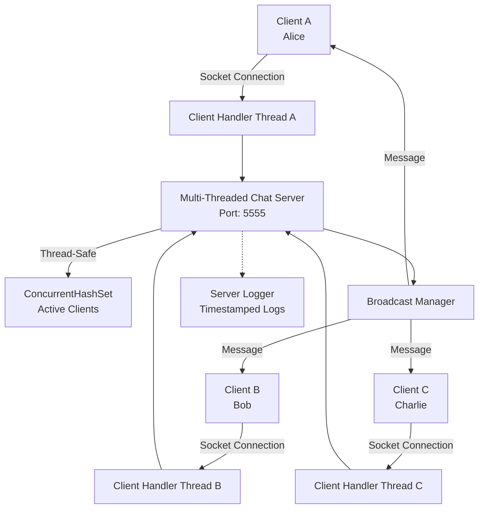
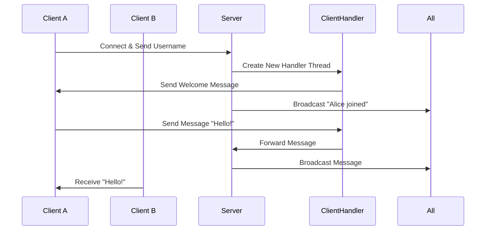

# Architecture Documentation

## Multi-Threaded Chat Server Architecture

### Overview

This chat application follows a **client-server architecture** with a multi-threaded server design. The server accepts multiple client connections simultaneously and handles each client in a dedicated thread, enabling real-time bidirectional communication.

---

## System Architecture



---

## Component Breakdown

### 1. **ChatServer.java** (Server Core)

**Responsibilities:**
- Initializes `ServerSocket` on port 5555
- Accepts incoming client connections
- Creates `ClientHandler` thread for each client
- Maintains centralized client list
- Broadcasts messages to all connected clients
- Manages server lifecycle (startup/shutdown)

**Key Methods:**
```java
- main(): Server entry point
- broadcastMessage(): Sends message to all clients
- removeClient(): Removes disconnected client
- shutdown(): Graceful server termination
```

---

### 2. **ClientHandler.java** (Client Thread)

**Responsibilities:**
- Handles communication with a single client
- Receives username during connection
- Reads incoming messages from client
- Sends messages to client
- Manages client lifecycle (connect/disconnect)

**Key Methods:**
```java
- run(): Main thread logic
- sendMessage(): Sends message to client
- handleDisconnect(): Cleanup on disconnect
- close(): Closes client resources
```

---

### 3. **ChatClient.java** (Client Application)

**Responsibilities:**
- Connects to server via IP and port
- Sends username for authentication
- Sends user messages to server
- Receives messages in separate thread
- Displays chat in real-time

**Key Methods:**
```java
- start(): Client initialization
- connect(): Establishes socket connection
- startReceiver(): Starts message receiver thread
- messageLoop(): Handles user input
```

---

### 4. **Message.java** (Data Model)

**Responsibilities:**
- Represents chat message with metadata
- Serializes/deserializes for network transmission
- Formats messages for display

**Fields:**
- `sender`: Username of message sender
- `content`: Message text
- `timestamp`: LocalDateTime when sent
- `type`: Message type (CHAT, JOIN, LEAVE)

---

## Data Flow

### Message Flow (Client → Server → Clients)



---

## Project Structure
